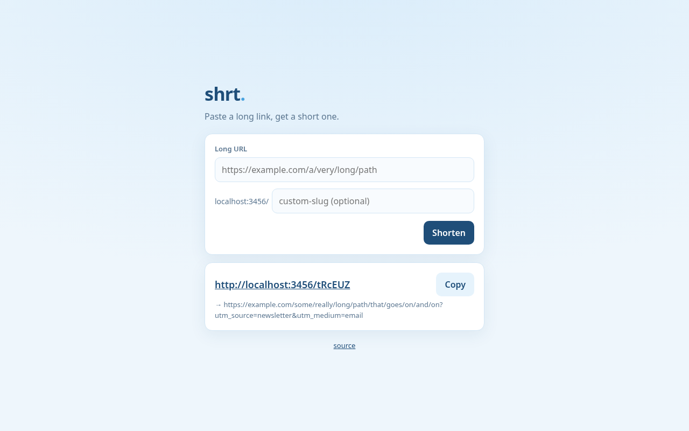

# shrt

[](https://github.com/dtxdex1020/shrt/actions/workflows/ci.yml)
[](https://hono.dev)
[](https://github.com/WiseLibs/better-sqlite3)
[](./Dockerfile)
[](./LICENSE)

A URL shortener you can read in ten minutes and deploy in two. One Node process, one SQLite file, one tiny page.

Custom slugs, click counts, rate limiting, input validation, and a Dockerfile. No accounts, no analytics dashboards, no tracking pixels.



## Quick start

```sh
git clone https://github.com/dtxdex1020/shrt && cd shrt
npm install
npm run dev          # http://localhost:3000
```

Production:

```sh
npm run build
cp .env.example .env # edit BASE_URL
node --env-file=.env dist/server.js
```

### Docker

```sh
docker build -t shrt .
docker run -d -p 3000:3000 -v shrt-data:/data -e BASE_URL=https://s.example.com shrt
```

The database lives at `/data/shrt.db`, so keep that volume. The image runs as a non-root user and has a health check on `/healthz`.

## API

| Method | Path               | Description                         |
| ------ | ------------------ | ----------------------------------- |
| `POST` | `/api/links`       | Create a link. Rate limited.        |
| `GET`  | `/api/links/:slug` | Link details and click count        |
| `GET`  | `/:slug`           | `302` to the target, counts a click |
| `HEAD` | `/:slug`           | Same redirect, not counted          |
| `GET`  | `/healthz`         | `{ "ok": true }`                    |
| `GET`  | `/`                | The web UI                          |

### Create a link

```sh
curl -X POST localhost:3000/api/links \
  -H 'content-type: application/json' \
  -d '{"url": "https://github.com/dtxdex1020", "slug": "dex"}'
```

```json
{
  "slug": "dex",
  "url": "https://github.com/dtxdex1020",
  "clicks": 0,
  "createdAt": "2026-10-09T18:00:00.000Z",
  "lastClickedAt": null,
  "shortUrl": "http://localhost:3000/dex"
}
```

Leave out `slug` for a random 6-character one (no look-alike characters like `0/O` or `1/l`).

### Errors

Every error is JSON with an `error` code and a readable `message`.

| Status | `error`           | When                                                            |
| ------ | ----------------- | --------------------------------------------------------------- |
| 400    | `invalid_request` | Missing or malformed body, bad slug (3-40 of `A-Z a-z 0-9 _ -`) |
| 400    | `invalid_url`     | Not an absolute http(s) URL, or a link back to shrt itself      |
| 400    | `slug_reserved`   | Slugs like `api` or `healthz`                                   |
| 409    | `slug_taken`      | Slugs are unique, case-insensitively                            |
| 429    | `rate_limited`    | Too many creates; see `Retry-After`                             |
| 404    | `not_found`       | Unknown slug                                                    |

## Configuration

All via environment variables, validated on startup with zod.

| Variable               | Default        |                                         |
| ---------------------- | -------------- | --------------------------------------- |
| `PORT`                 | `3000`         |                                         |
| `HOST`                 | `0.0.0.0`      |                                         |
| `DATABASE_PATH`        | `data/shrt.db` | Created if missing                      |
| `BASE_URL`             | request origin | Public origin used in `shortUrl`        |
| `RATE_LIMIT`           | `30`           | Link creations per client per window    |
| `RATE_LIMIT_WINDOW_MS` | `60000`        |                                         |
| `TRUST_PROXY`          | `false`        | Use `X-Forwarded-For` for the client IP |

The rate limiter is in memory, which is right for a single instance. Running several? Put the limit in your proxy instead.

## Why

Every shortener I tried was either a SaaS that wants a login and a tracking script, or a self-hosted app with Redis, Postgres and an admin panel. For personal links and campaign URLs you need a table with four columns. `better-sqlite3` is synchronous and fast, Hono keeps the HTTP layer tiny, and the whole thing fits on the smallest VPS you can buy.

## Development

```sh
npm test        # vitest, API tests run against an in-memory database
npm run lint    # eslint + prettier + tsc
npm run build
```

## License

[MIT](./LICENSE)
